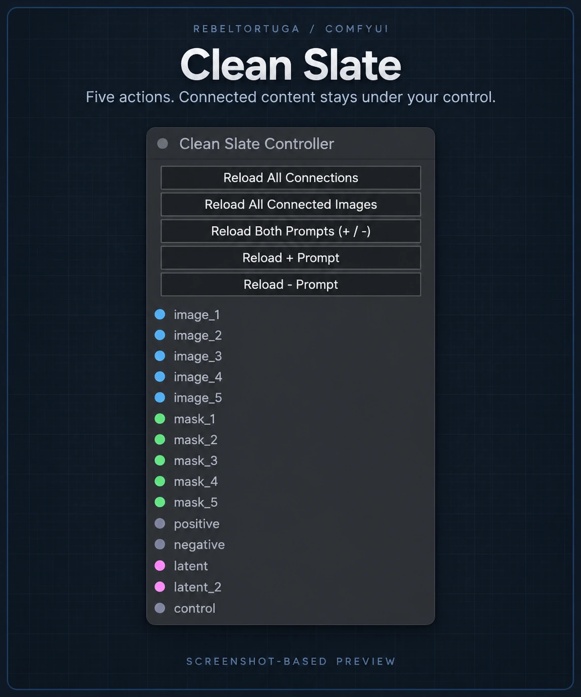
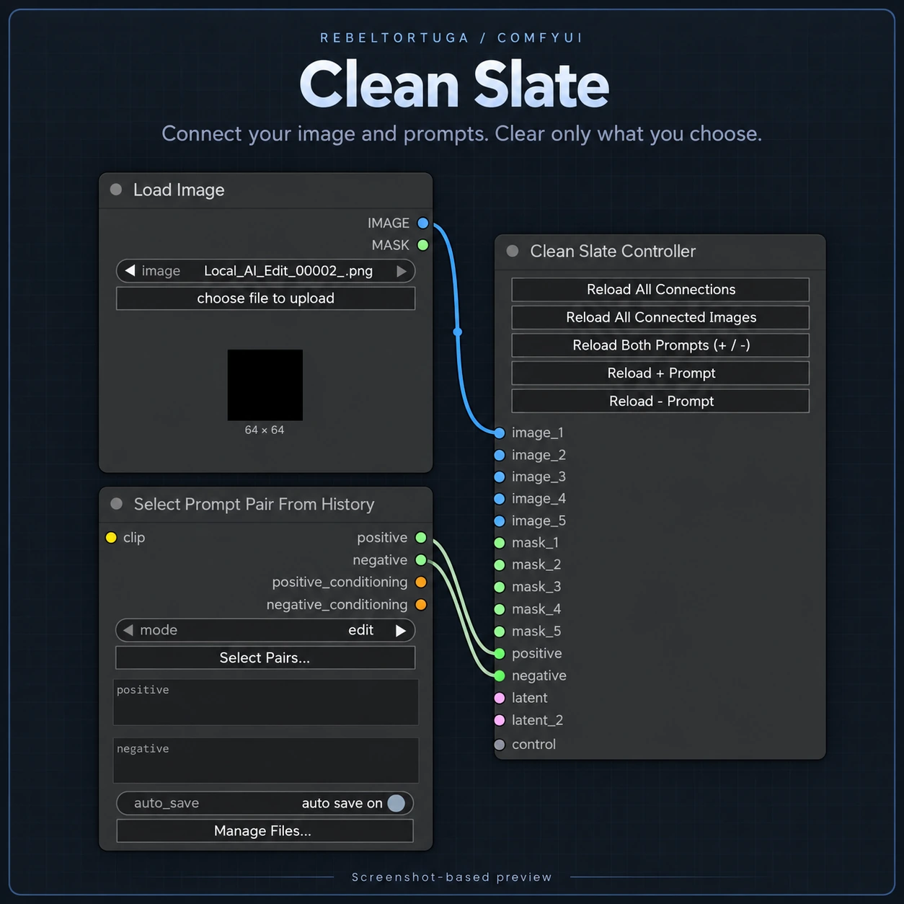
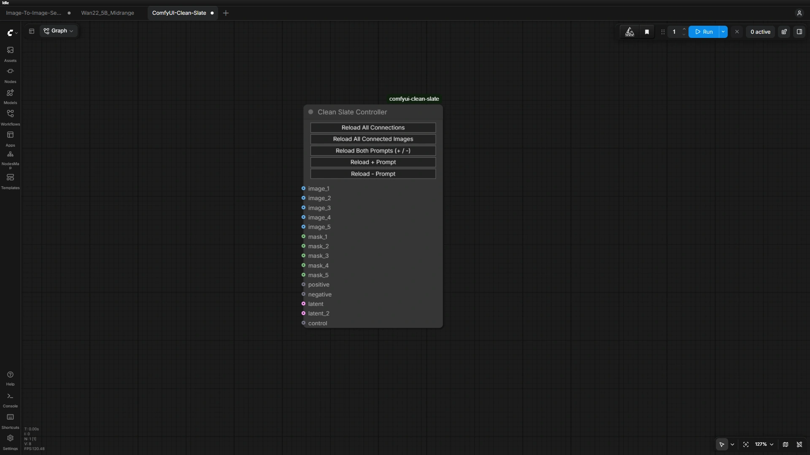
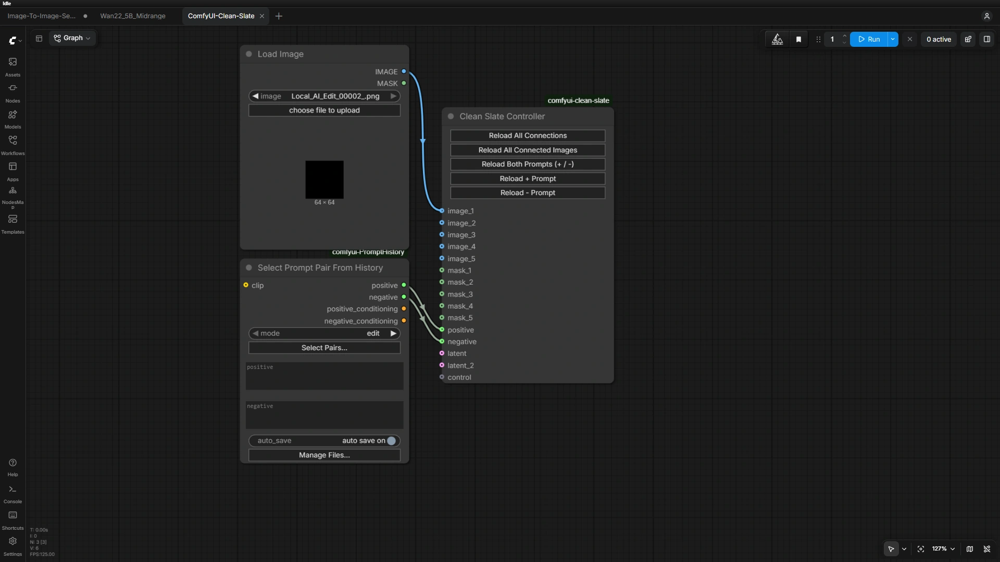

<!-- rebeltortuga-banner:start -->

<a href="https://rebeltortuga.github.io/">Website</a> · <a href="https://github.com/RebelTortuga">GitHub</a> · <a href="https://www.twitch.tv/rebeltortuga">Twitch</a> · <a href="https://www.youtube.com/channel/UCpMIirV8w5RfVd9TpKpA2pQ">YouTube</a> · <a href="https://www.patreon.com/cw/RebelTortuga">Patreon</a> · <a href="https://ko-fi.com/rebeltortuga">Ko-fi</a>

<!-- rebeltortuga-banner:end -->

# ComfyUI Clean Slate

Clear connected images and prompts while keeping workflow connections, saved files and prompt history intact.

**Release: v0.2.0** · **License: MIT** · **Free local extension**

## Preview

*Screenshot-based promotional previews. Original screenshots below remain the interface reference.*

## Five actions, in order

| Button | What it clears |
| --- | --- |
| Reload All Connections | Connected image selections, mask/latent branch previews and both prompts |
| Reload All Connected Images | Connected image selections and image/mask/latent branch previews |
| Reload Both Prompts (+ / -) | Both connected active prompt fields |
| Reload + Prompt | Connected positive prompt fields only |
| Reload - Prompt | Connected negative prompt fields only |

“Reload” is the button label. Actions clear selected content and refresh the display; they do not recreate nodes, reconfigure nodes, disconnect wires, execute generation or restart ComfyUI. Every action asks for confirmation first. Cancel or Esc leaves content unchanged; the final OK message reports completion.

## Connections

| Input | Count | Connect from |
| --- | --- | --- |
| image_1–image_5 | 5 | IMAGE outputs of image sources or preview branches |
| mask_1–mask_5 | 5 | MASK outputs |
| positive / negative | 2 | Matching STRING outputs or separate text-encoder CONDITIONING outputs |
| latent / latent_2 | 2 | LATENT outputs, such as KSampler |
| control | 1 | Optional control-node output; the controller does not reset its settings |

These are additional branches: leave the workflow's existing wires connected. Connecting a latent or processed-image output clears conventional previews on that branch; it does not delete latent tensors. Clearing a processed mask does not erase mask files. A directly connected Load Image source has its current selection cleared.

Supports paired `positive`/`negative` fields, standard `text`/`prompt` fields, `text_g`/`text_l`/`text_t5`, and linked text sources/reroutes. Arbitrary third-party field names or conditioning-processing chains may require adapters.

## Install or update

1. Stop ComfyUI. Download the release ZIP and extract `comfyui-clean-slate` into `ComfyUI/custom_nodes/`. Replace the existing files; do not install a second copy.
2. Restart ComfyUI and hard-refresh its browser with Ctrl+F5.
3. Add **Clean Slate Controller** under **RebelTortuga / Utilities**. When updating an old workflow with obsolete sockets, add a fresh controller and reconnect it before removing the old one.
4. Load `examples/ComfyUI-Clean-Slate.json` for a blank image/paired-prompt wiring example. That example also requires [PromptHistory](https://github.com/dawncreatescode/comfyui-PromptHistory). The extension itself has no extra Python dependencies.

## Cleared previews and saved size

Cleared conventional image previews stay blank across workflow-tab reconstruction. New execution releases the preview-clear markers so fresh results can appear. Select a new source image before running after clearing. Save the workflow to retain blank values across reopening.

The buttons sit above the sockets. Resize the controller as desired and save: tab restoration preserves its saved width and height.

## Fixed image-edit mode node

This release also includes **Image Edit Mode (1 Auto / 2 Painted Mask)** (`CleanSlateImageMode`). It has exactly two IMAGE inputs and one IMAGE output: mode 1 selects the automatic result; mode 2 selects the painted-mask composite. Inputs do not grow dynamically. This is used by the [Qwen image-edit workflow](https://github.com/RebelTortuga/comfyui-free-local-qwen-image-edit).

## Validation and limits

The author confirmed generation, clearing, Cancel and saved-size behavior in their ComfyUI setup. Isolated tests also cover prompt polarity, tab-restored caches, cancellation, size preservation and image-mode branch selection. A clean-machine GPU installation was not tested. Targets the classic canvas renderer; third-party preview caches and Nodes 2.0 require separate compatibility checks.

No saved image files or history files are deleted. Histories stay on each user's machine; no personal images or active prompts are bundled. This is an independent community extension, not an official ComfyUI product.

## 🔗 Related Free RebelTortuga Projects

Explore other free tools and workflows:

- [comfyui-free-local-qwen-image-edit](https://github.com/RebelTortuga/comfyui-free-local-qwen-image-edit)
- [comfyui-free-local-sdxl-inpainting](https://github.com/RebelTortuga/comfyui-free-local-sdxl-inpainting)
- [comfyui-free-local-wan-video-quality](https://github.com/RebelTortuga/comfyui-free-local-wan-video-quality)
- [comfyui-free-local-wan-video-high-resolution](https://github.com/RebelTortuga/comfyui-free-local-wan-video-high-resolution)

[Browse all RebelTortuga projects](https://github.com/RebelTortuga)

## 🐢 Support RebelTortuga

Clean Slate is completely free to use. No payment or donation is required!

If this node has helped you, consider supporting its development.

☕ **[Help this turtle get a new shell!](https://ko-fi.com/rebeltortuga)** 🐢💚

Your support helps me continue improving Clean Slate, developing new ComfyUI tools, and sharing free projects with the community.

**No pressure. No paywalls. Just one rebellious turtle with big ideas!**

## License

MIT; see [LICENSE](LICENSE).

---

<!-- BEGIN REBELTORTUGA SAFETY -->
## Privacy & Software Safety

Read the [project safety guidance](SAFETY.md) before use. It covers local workflows, dependencies, saved files, and security warnings. See [SECURITY.md](SECURITY.md) for vulnerability reporting and the [license](LICENSE) for terms.

[Privacy & Software Safety](https://rebeltortuga.github.io/privacy-software-safety.html) · [Project Licenses](https://rebeltortuga.github.io/project-licenses.html)

Do not upload passwords, access tokens, browser profiles, private backups, or unredacted diagnostic reports to public issues.
<!-- END REBELTORTUGA SAFETY -->

<!-- rebeltortuga-official-links:start -->
## Official RebelTortuga links

- 🌐 [Website](https://rebeltortuga.github.io/)
-  [GitHub](https://github.com/RebelTortuga)
-  [Twitch](https://www.twitch.tv/rebeltortuga)
-  [YouTube](https://www.youtube.com/channel/UCpMIirV8w5RfVd9TpKpA2pQ)
-  [Patreon](https://www.patreon.com/cw/RebelTortuga)
-  [Ko-fi](https://ko-fi.com/rebeltortuga)
<!-- rebeltortuga-official-links:end -->

## Official Project Guide

[View the comfyui-clean-slate project guide](https://rebeltortuga.github.io/projects/comfyui-clean-slate.html)

