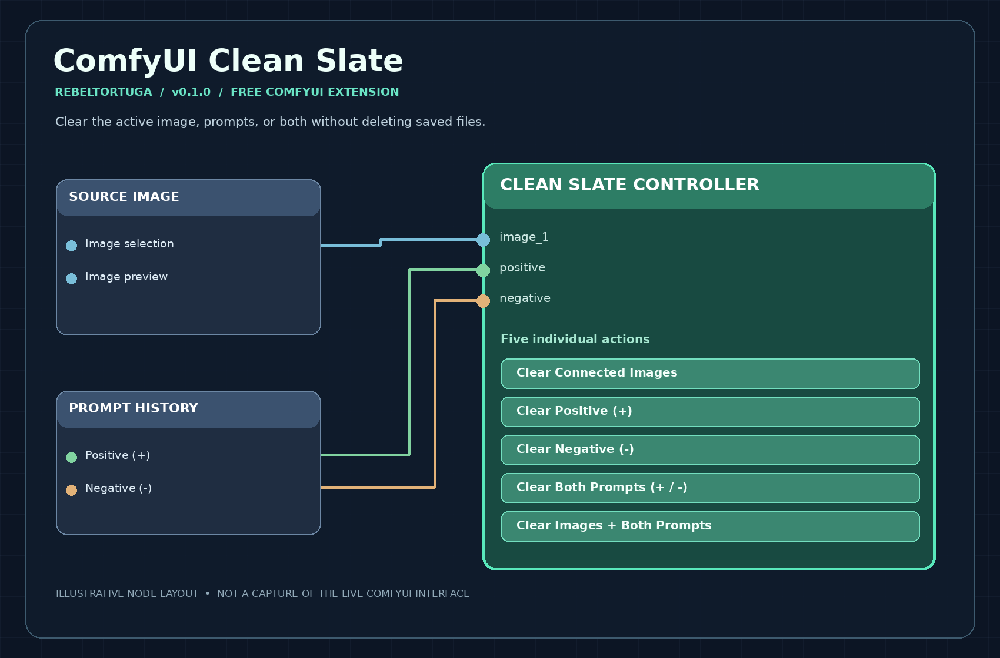

# ComfyUI Clean Slate

A standalone, connection-based ComfyUI node to clear **current images and/or prompts** without deleting your image library or saved prompt history.

**Developer:** RebelTortuga  
**Release:** v0.1.0  
**Platform:** Windows 10/11, ComfyUI (including Stability Matrix)  
**License:** MIT  
**Price:** Free; no payment required

An independent ComfyUI extension, not an official ComfyUI product.

## Preview

*Illustration of the controller's connections and five buttons; not a live ComfyUI screenshot.*

## Features

- Provides a separate **Clean Slate Controller** node under **RebelTortuga / Utilities**. It does not add buttons to any existing node.
- Connect up to eight image outputs, four mask outputs, and positive/negative STRING prompt outputs to identify exactly which sources it controls.
- Five individual controls: **Clear Connected Images**, **Clear Positive (+)**, **Clear Negative (−)**, **Clear Both Prompts**, and **Clear Images + Both Prompts**.
- Confirms before making changes.
- Clears image-selection fields and cached previews in connected source-image nodes, alongside positive/negative fields of connected Prompt History nodes. Also guards against a previously cached preview reappearing when a workflow tab reloads.
- Keeps node positions, all connections, models, sampler settings, and non-prompt controls intact.
- **Never deletes or archives files.** Existing images, dropdown history, and prompt-history files stay untouched.
- Does not automatically save the reset workflow; save manually if desired.

## Installation

1. Stop ComfyUI in Stability Matrix.
2. Extract the `comfyui-clean-slate` directory into your ComfyUI installation's `custom_nodes` directory:

   `ComfyUI/custom_nodes/comfyui-clean-slate/`

3. Restart ComfyUI and refresh the browser with **Ctrl+Shift+R**.
4. Right-click the canvas, search **Clean Slate Controller**, and add it near your source images and prompt-history node.
5. Connect each **Load Image → IMAGE** output to a controller `image_1` through `image_8` input. These are **additional branches**; existing connections stay connected.
6. Connect **Prompt History → positive** to controller `positive`, and **Prompt History → negative** to controller `negative`.
7. Click one of the five controller buttons and confirm. Only linked source nodes are affected.

No extra Python dependencies, credentials, or paid services are required.

## Important behavior and limitations

The image-selection value is set to an empty string. That state is not a valid source for image generation: select/upload a new image before running. ComfyUI may restore an old thumbnail in `node.imgs` while switching tabs even when the selected filename remains blank. Clean Slate checks the active canvas every 250 ms and removes such stale previews; it skips images with a selected filename. Save with **Ctrl+S** to persist changed widget values.

ComfyUI extensions and image nodes have different preview implementations. This release clears conventional LiteGraph `node.imgs` previews and known image-loader widgets, but some third-party nodes may store images in private caches or draw separate preview elements. Those require compatibility testing and possibly a node-specific adapter. The controller affects **only connected sources** on the active canvas, not every node automatically.

**Testing:** The standalone controller was previously tested in ComfyUI 0.42.1. The active-tab stale-preview watcher passed isolated JavaScript tests but requires a fresh live ComfyUI test. Compatibility with all third-party image-preview implementations is not established. Back up your workflow JSON before first use.

## Frequently asked questions and troubleshooting

**Where is the controller after installation?** Restart ComfyUI, hard-refresh the browser (`Ctrl+Shift+R`), then search for **Clean Slate Controller** under **RebelTortuga / Utilities**.

**Why didn't a particular image or prompt clear?** The controller only operates on connected source nodes on the active canvas. Check the extra IMAGE/STRING connections. Some third-party preview widgets may require compatibility work.

**Did clearing delete my image files?** No. It clears current selections and known cached previews, not saved images, prompt-history files, or the image library.

**Why can't I run generation immediately after clearing?** An image-loader field may now be empty. Select or upload a new image first.

**Why do cleared values return after restarting ComfyUI?** Save the workflow after clearing if you want the empty state persisted. Back up your workflow JSON before first use.

## 🔗 Related Free RebelTortuga Projects

Explore other free tools and workflows:

- [comfyui-free-local-qwen-image-edit](https://github.com/RebelTortuga/comfyui-free-local-qwen-image-edit)
- [comfyui-free-local-sdxl-inpainting](https://github.com/RebelTortuga/comfyui-free-local-sdxl-inpainting)
- [comfyui-free-local-wan-video-quality](https://github.com/RebelTortuga/comfyui-free-local-wan-video-quality)
- [comfyui-free-local-wan-video-high-resolution](https://github.com/RebelTortuga/comfyui-free-local-wan-video-high-resolution)

[Browse all RebelTortuga projects](https://github.com/RebelTortuga)

## 🐢 Support RebelTortuga

Clean Slate is completely free to use. No payment or donation is required!

If this node has helped you, consider supporting its development.

☕ **[Help this turtle get a new shell!](https://ko-fi.com/rebeltortuga)** 🐢💚

Your support helps me continue improving Clean Slate, developing new ComfyUI tools, and sharing free projects with the community.

**No pressure. No paywalls. Just one rebellious turtle with big ideas!**

## License

MIT; see [LICENSE](LICENSE).

---

<!-- BEGIN REBELTORTUGA SAFETY -->
## Privacy & Software Safety

Read the [project safety guidance](SAFETY.md) before use. It covers local workflows, dependencies, saved files, and security warnings. See [SECURITY.md](SECURITY.md) for vulnerability reporting and the [license](LICENSE) for terms.

[Privacy & Software Safety](https://rebeltortuga.github.io/privacy-software-safety.html) · [Project Licenses](https://rebeltortuga.github.io/project-licenses.html)

Do not upload passwords, access tokens, browser profiles, private backups, or unredacted diagnostic reports to public issues.
<!-- END REBELTORTUGA SAFETY -->

<!-- rebeltortuga-official-links:start -->
## Official RebelTortuga links

- [Website](https://rebeltortuga.github.io/)
- [GitHub](https://github.com/RebelTortuga)
- [Twitch](https://www.twitch.tv/rebeltortuga)
- [▶ YouTube](https://www.youtube.com/channel/UCpMIirV8w5RfVd9TpKpA2pQ)
- [Patreon](https://www.patreon.com/RebelTortuga)
- [Ko-fi](https://ko-fi.com/rebeltortuga)
<!-- rebeltortuga-official-links:end -->

## Official Project Guide

[View the comfyui-clean-slate project guide](https://rebeltortuga.github.io/projects/comfyui-clean-slate.html)
